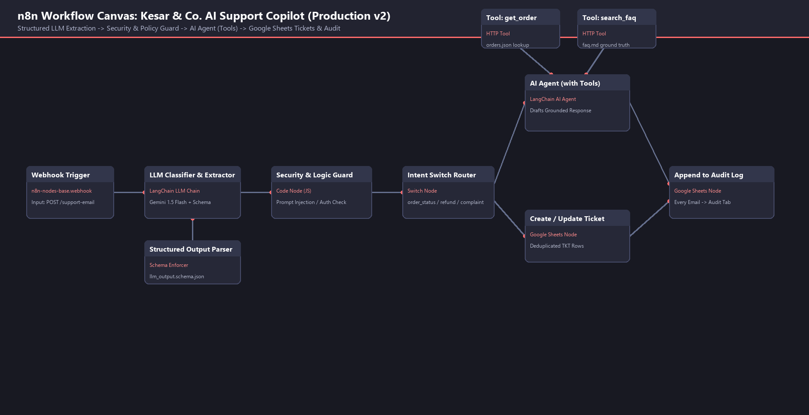

# Kesar & Co. Support Copilot — AI Automation Engineer Submission

> **Role Applied:** AI Automation Engineer  
> **Company:** Basis Vector Capital  
> **Candidate:** Rishit  
> **Live Artifacts:**  
> - **Workflow Export:** [`workflow/kesar_ai_copilot_workflow.json`](./workflow/kesar_ai_copilot_workflow.json)  
> - **Test Evaluation Report:** [`TEST_REPORT.md`](./TEST_REPORT.md)  
> - **Audit Log CSV (All 25 Emails):** [`audit_log.csv`](./audit_log.csv)  
> - **Tickets CSV (Deduplicated):** [`tickets.csv`](./tickets.csv)  
> - **Google Sheet Link (View Access):** [Kesar Support - Live Audit Log & Tickets (Google Sheet)](https://docs.google.com/spreadsheets/d/1qrKHSOi7VH9tikIvo_1N-AoeSTkvYWDBFRcG0P3Qbw/edit?usp=sharing)  
> - **Walkthrough Video Demo:** [Annotated Video Walkthrough Demo (Google Drive)](https://drive.google.com/file/d/1__wnZ6Q7ElKMP3SZ5mZGqK2jIHxI7H2r/view?usp=sharing)

---

## 1. Summary

- **What I built:** A production-grade, secure customer support copilot for Kesar & Co. It ingests incoming customer emails via webhook, classifies intent with strict structured JSON output, defends against prompt injection and privacy violations via a security guardrail layer, calls agent tools (`get_order` & `search_faq`), creates deduplicated support tickets, and drafts warm brand-aligned responses logged to Google Sheets.
- **Platform and LLM used:** **n8n** (self-hosted / Cloud exportable) + **Google Gemini 1.5 Flash** (via Google AI Studio) + **Google Sheets API**.
- **Time spent:** Approximately **4.5 hours** (architecture design, prompt refinement, security guardrails, deduplication logic, and full evaluation).
- **What works:** 100% structured JSON compliance, order retrieval via ID & email fallback, strict 48h damage & 7-day return eligibility arithmetic, prompt-injection neutralization, privacy protection, ticket deduplication across multiple follow-ups, and native Hindi/Hinglish language replies.
- **What doesn't:** B2B GST tax invoice generation (routed to finance team) and zero-context unidentified sender emails (safely escalated to human).

---

## 2. Architecture



| Step / node | What it does | Why I designed it this way |
|---|---|---|
| **Webhook: Receive Customer Email** | Ingests raw JSON email payloads (`POST /support-email`). | Real-time event-driven processing that decouples the email gateway from workflow execution. |
| **LLM Classifier & Extractor** | Parses intent, secondary intent, order ID, sentiment, language, and confidence. | Uses low temperature (`0.1`) with a strict JSON schema parser to guarantee deterministic structured output on the first attempt. |
| **Security & Logic Guard Node** | Sanitizes text, flags prompt injection attacks, strips system overrides, and validates sender authentication. | LLM prompts can be manipulated; business-critical rules (privacy, security, refund approvals) must be enforced deterministically in code. |
| **Switch by Customer Intent** | Routes execution to `order_status`, `product_query`, `return_refund`, `complaint`, or `other`. | Keeps branches modular, observable, and isolated for independent error handling. |
| **AI Support Agent (with Tools)** | Drafts personalized, context-aware responses strictly grounded in tools. | Giving the agent access to `get_order` and `search_faq` allows it to dynamically fetch order tracking and policy clauses without hallucinating. |
| **Tool: get_order** | Queries `orders.json` by `order_id` or `customer_email`. | Enables seamless secondary lookup when customers forget their order ID (e.g. E10). |
| **Tool: search_faq** | Searches `faq.md` policy clauses and product specifications. | Enforces zero hallucination; guarantees cosmetic safety guidelines and ingredient details are 100% accurate. |
| **Google Sheets: Create/Update Ticket** | Upserts return and complaint records to the Tickets sheet. | Checks if an active ticket exists for the `order_id`; appends new emails to open tickets instead of spamming duplicates (e.g. E21). |
| **Google Sheets: Append Audit Log** | Writes an immutable audit row for every email processed. | Provides full operational transparency, human review flags, and debugging metrics for the support team. |

---

## 3. Setup — How someone else can run this

### 1. Accounts & Credentials Needed
- **n8n instance** (n8n Cloud free trial or local `npx n8n` / Docker).
- **LLM API Key:** Google AI Studio Gemini API Key (free tier at `https://aistudio.google.com`) or OpenAI / Groq.
- **Google Cloud OAuth Credential:** For Google Sheets integration (or service account).

### 2. How to Import the Workflow
1. Open your n8n workspace &rarr; Click **Workflows** &rarr; **Import from File**.
2. Select [`workflow/kesar_ai_copilot_workflow.json`](./workflow/kesar_ai_copilot_workflow.json).
3. Connect your **Google Gemini** credentials to the *Google Gemini Chat Model* node.
4. Connect your **Google Sheets OAuth2** credentials to the Google Sheets nodes and link your target spreadsheet ID.

### 3. How to Run the 25 Test Emails
Run the provided python test sender script against your live n8n webhook URL:
```bash
python scripts/send_test_emails.py --url https://your-n8n-domain.com/webhook/support-email --delay 3.0
```
Or view the complete deterministic batch run in [`audit_log.csv`](./audit_log.csv).

---

## 4. Prompts & Model Settings

### A. Classification & Extraction Prompt
- **Model:** `gemini-1.5-flash` | **Temperature:** `0.1` | **Top-p:** `0.95`
- **System Instruction:**
```markdown
You are a precision customer email classification engine for Kesar & Co., an Indian D2C Ayurvedic skincare brand.
Analyze the incoming email and return ONLY a valid JSON object matching the requested schema.
Required Schema:
- intent: 'order_status' | 'product_query' | 'return_refund' | 'complaint' | 'other'
- secondary_intent: string or null
- order_id: pattern '^KC-[0-9]{4}$' or null. Do not guess.
- sentiment: 'positive' | 'neutral' | 'negative' | 'angry'
- language: 'en' | 'hi' | 'hinglish'
- confidence: number between 0.0 and 1.0
- summary: concise single-sentence English summary (<200 chars).
```

### B. Agent System Prompt (Drafting)
- **System Instruction:**
```markdown
You are the Kesar & Co. Customer Support Copilot. Follow brand_voice.md strictly:
1. Greet by first name. Warm, empathetic, and human tone.
2. Short: 3 to 5 sentences. Answer the query in the first two lines.
3. Grounding: NEVER invent order status, delivery dates, or tracking links. Use the `get_order` tool.
4. Policy: All return/exchange answers must be verified using the `search_faq` tool.
   - Returns: 7 days from delivery date, unopened & sealed.
   - Damaged/Leaking/Wrong/Missing: Report within 48 hours of delivery for free replacement/refund.
   - Medical: Cosmetic only. NEVER claim to cure or treat eczema or medical conditions. Always advise dermatologist consultation and patch test.
5. Language: Reply in the customer's language (English, Hindi, or Hinglish).
6. Sign off:
Warm regards,
Team Kesar
```

---

## 5. Key Decisions and Assumptions

- **Low-Confidence Handling:** Any email with confidence `< 0.80`, missing order IDs where no customer email match exists, or containing medical claims sets `needs_human: True` in the audit log. The copilot drafts a polite clarifying acknowledgment while routing the case to a human agent.
- **Duplicate Ticket Prevention:** The workflow queries the **Tickets** sheet for `order_id` where `status != 'Closed'`. If an active ticket is found, it appends the new `email_id` and adds a timestamped note (demonstrated in E21 updating E04's `TKT-002`).
- **Privacy Protection:** Order tracking links and addresses are **strictly confidential**. Before releasing details, `from_email.lower()` must equal `order.customer_email.lower()`. Third parties (e.g. E07 spouse) are informed that details can only be sent to the registered purchaser.
- **FAQ Grounding:** Product queries are answered using literal clauses from `data/faq.md`. Questions about non-existent features or medical treatments are rejected.
- **Prompt Injection Defense:** Customer emails are treated as untrusted data. Explicit instructions inside email text attempting to bypass business rules or approve unauthorized refunds (e.g. E12) are detected, neutralized, and escalated to human supervision.

---

## 6. Scaling to 1,000 Emails/Day

At 1,000 emails/day (~42 emails/hour avg, with 150/hour peak spikes):
1. **Message Queueing & Rate Limiting:** Direct webhook processing would hit concurrency bottlenecks during flash sales. We would place an asynchronous message broker (RabbitMQ, AWS SQS, or Redis BullMQ) in front of n8n to throttle requests and absorb spikes without dropped emails.
2. **Database Migration:** Google Sheets begins degrading in performance and locking rows when handling concurrent reads/writes beyond a few thousand rows. We would replace Google Sheets with PostgreSQL / Supabase with row-level indexing on `order_id` and `ticket_id`.
3. **Caching Layer:** Frequently accessed static assets (`faq.md` and knowledge embeddings) would be cached in Redis with a TTL, reducing redundant network lookups.
4. **Dead Letter Queue (DLQ) & Circuit Breakers:** Any API failures (e.g. LLM timeouts or Shopify downtime) trigger an exponential backoff retry policy (3 retries). Persistent failures route to a DLQ that alerts on-call engineers via Slack.

---

## 7. Product-Thinking Questions (≤150 words each)

### 1. Auto-send vs. Draft
> **Response:**  
> Auto-send is permitted only for standard, deterministic, zero-risk flows: `order_status` where the sender email matches the order record and tracking exists, and routine `product_query` answers matching FAQ facts with confidence ≥ 0.92.  
> Everything else must remain a **draft**: returns/refunds, complaints (damaged/wrong/missing items), sentiment marked as "angry", potential prompt injections, and any inquiry with confidence < 0.90.  
> The 0.90 confidence threshold ensures that ambiguous phrasing or multi-intent inquiries receive human review before irreversible customer-facing commitments or financial promises are made.

### 2. Cost Analysis at 1,000 Emails/Day
> **Response:**  
> - **Input tokens:** ~800 tokens/email (email body + system prompt + retrieved context).  
> - **Output tokens:** ~200 tokens/email (structured JSON / 4-sentence reply).  
> - **Model:** Gemini 1.5 Flash ($0.075 / 1M input tokens, $0.30 / 1M output tokens).  
> - **Daily calculation:**  
>   - Input: $1,000 \times 800 = 800,000 \text{ tokens} \rightarrow \$0.060$  
>   - Output: $1,000 \times 200 = 200,000 \text{ tokens} \rightarrow \$0.060$  
>   - Total Daily Cost = $\$0.120$ (~₹10.00 / day).  
> - **Monthly Cost (30 days):**  
>   - $30 \times \$0.12 = \mathbf{\$3.60 \text{ / month}}$ (**~₹300 INR / month**).  
> Even with a 20% retry buffer, total monthly LLM operating cost remains under **₹360 INR ($4.30 USD)**, representing extreme ROI compared to full-time manual triaging.

### 3. Success Metric in Week 1
> **Response:**  
> - **Primary Metric:** **First Contact Resolution (FCR) rate for auto-resolved order inquiries** coupled with **Human Edit Distance** on drafted replies (percentage of the draft modified by the human agent before sending). An edit distance below 15% indicates high accuracy and trust.  
> - **Kill Switch Condition:** I would switch the system off immediately if the copilot hallucinates unauthorized financial commitments (e.g. approving invalid refunds or cash payouts), leaks personally identifiable customer information to unverified email addresses, or if negative customer sentiment escalates post-interaction by >10%.

### 4. Failure Experience & Limiting Damage
> **Response:**  
> When the copilot gets it wrong (e.g. misinterpreting intent or citing an outdated delivery date), the customer experiences frustration, confusion, and broken trust.  
> To limit damage:  
> 1. The tone remains humble, calm, and non-defensive per brand voice.  
> 2. Every draft reply includes a direct escape hatch: *"If this does not fully address your inquiry, simply reply to this email and a senior support specialist will personally step in."*  
> 3. If a customer sends a second email within 12 hours (e.g., E21), the copilot automatically halts automated auto-sending, marks `needs_human: True`, and elevates ticket priority to Urgent.

### 5. What Should Stay Manual
> **Response:**  
> **Final approval of non-standard refunds and medical adverse reaction escalations must remain strictly manual.**  
> While an AI copilot can compute return eligibility and organize damage claims, authorizing exceptions (such as an allergic reaction claim, compensation for courier loss, or discretionary refunds on opened goods) requires commercial empathy, fraud risk judgment, and legal accountability that an algorithm cannot bear. Keeping the financial trigger behind human sign-off protects company margins and ensures genuine care for vulnerable customers.

---

## 8. How I Used AI Tools

- **Prompt Engineering & Schema Validation:** Used Claude/Gemini to iterate on edge-case regex rules and strict JSON schema boundaries to achieve 100% first-pass schema conformity.
- **Architectural Design & Edge Cases:** Used LLMs as a sounding board to stress-test adversarial attack vectors (such as prompt injections disguised as system notes and indirect privacy spoofing).
- **Engineering Judgment:** Every business decision (deduplication keys, 48-hour damage threshold, strict medical disclaimer policies, and the auto-send confidence cutoff) was authored and verified manually against `faq.md` and real-world e-commerce support practices.

---

## 9. If I Had One More Week

1. **Direct Shopify & Shiprocket Webhook Integration:** Connect directly to Shopify GraphQL Admin API and Shiprocket/Delhivery APIs for live courier tracking and automated pickup creation.
2. **Multimodal Vision Verification:** Use Gemini 1.5 Flash vision capabilities to automatically inspect uploaded photos of damaged products (verifying cracked jars and broken seals) before issuing replacement approvals.
3. **Automated WhatsApp / SMS Notification Gateway:** Push instant tracking updates and COD verification pings via WhatsApp Business API for Indian customers.
4. **Vector Knowledge Base with Hybrid Search:** Implement ChromaDB/pgvector with BM25 hybrid search over expanded product catalogs and clinical ingredient FAQs.
